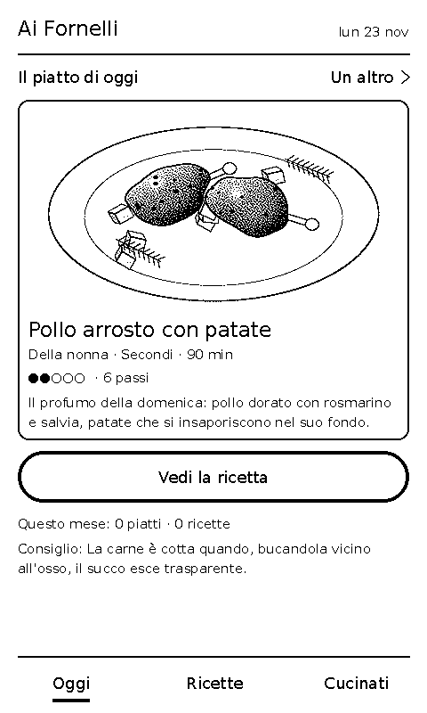

# Ai Fornelli — ricettario per Xteink X4 Pro

Un'app (InkApp) per il lettore e-ink **Xteink X4 Pro**: il ricettario da tenere in piedi accanto ai
fornelli. Contiene le 5 ricette del *Quaderno delle Ricette Sburrate* di Chef Leo e 12 classici della
nonna, ognuna con un'illustrazione in bianco e nero disegnata apposta per lo schermo e-ink.



## Cosa fa

| Schermata | |
|---|---|
| **Oggi** | il piatto del giorno (cambia ogni giorno; "Un altro" ne propone un altro), quanti piatti hai cucinato questo mese, un consiglio o il timer acceso |
| **Ricette** | le 17 ricette con miniatura; categorie (Primi, Secondi, Zuppe, Pizza, Dolci) e filtri (Chef Leo, Nonna, Sotto 30 min, Facili, Mai fatte); si sfoglia con uno swipe o con i tasti laterali |
| **Ricetta** | foto grande, tempo, difficoltà, dosi che si ricalcolano con **−** e **+**, ingredienti, Consigli |
| **Cucina** | un passo alla volta, con caratteri grandi; i passi con un tempo hanno il **timer** (anche più timer insieme, e continuano se esci dall'app). Il lettore non suona: a tempo scaduto lo schermo lampeggia e compare un avviso. Mentre cucini il lettore non va in standby |
| **Cucinati** | il calendario del mese con i giorni in cui hai cucinato e l'elenco dei piatti; finita una ricetta la segni qui. Tieni premuto un piatto per toglierlo |

Tasti laterali: avanti/indietro tra i passi e le pagine; **Indietro** torna alla schermata precedente.

## Installarla sul lettore

1. Scarica `dist/aifornelli.xtapp`.
2. Sul lettore: menu laterale (≡) → **Modalità USB**, collegalo al computer e copia il file nella
   cartella principale della scheda SD. Espelli ed esci dalla modalità USB.
3. Sul lettore apri **Tutti i file**, tocca `aifornelli.xtapp` e conferma l'installazione: compare
   "Installed".
4. Solo la prima volta: **Impostazioni → Info**, tocca **Modello** 10 volte di fila (meno di 2 secondi
   tra un tocco e l'altro). Nel menu laterale compare la voce **Ink App**.
5. ≡ → **Ink App** → **Ai Fornelli**. Per uscire: il tasto Home sotto lo schermo → *Leave app*.

Se compare "Install failed", il firmware del lettore usa una chiave diversa da quella nota (vedi sotto).
Reinstallando sopra una versione vecchia, i dati (diario, porzioni, timer) restano.

## Da sapere

- Il formato dei pacchetti `.xtapp` e l'API del lettore **non sono documentati da Xteink**: li ha
  ricostruiti la comunità ([touch-licorice-apps](https://github.com/omer-faruq-xteink/touch-licorice-apps),
  licenza MIT), da cui vengono `vendor/xtpack.py`, `vendor/gamekit.lua.in` e `vendor/lualint55.py`.
  L'app è stata provata solo sul **simulatore** (`tools/anteprima.py`), non ancora su un lettore vero.
- Le lettere accentate (à è ì ò ù) e i simboli ½ · ° dovrebbero esserci nel carattere del lettore,
  ma non è documentato: è la prima cosa da guardare alla prima apertura.

## Per modificarla

| Cosa | Dove |
|---|---|
| le ricette (testi, dosi, tempi dei timer) | `src/ricette.lua` — i numeri tra graffe `{500}` si ricalcolano con le porzioni |
| le schermate | `src/main.lua` |
| le illustrazioni | `tools/piatti.py` (un disegno per ricetta) e `tools/arte.py` (pennelli e dithering) |

```bash
pip install pillow numpy lupa cryptography
python3 -I tools/make_art.py      # ridisegna le foto (data/*.txt, icon.png, art/)
python3 -I tools/test_app.py      # i test sul simulatore
python3 -I tools/anteprima.py     # le schermate in art/schermate/
python3 -I tools/build.py         # crea dist/aifornelli.xtapp
```

Una ricetta nuova: aggiungila in `src/ricette.lua` con un `id` nuovo, aggiungi il suo disegno in
`tools/piatti.py` (dizionario `PIATTI`), poi `make_art.py`, `test_app.py` e `build.py`.
