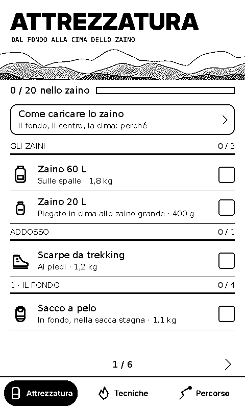

# Bivacco — la montagna in tasca, per Xteink X4 Pro

Un'app (InkApp) in italiano per il lettore e-ink **Xteink X4 Pro**, con tre schede. È alla versione 0.3:
contenuti, disegni e la grafica "taccuino da campo" ci sono; la mappa arriverà dopo.



| Scheda | Cosa c'è |
|---|---|
| **Attrezzatura** | Le 20 voci della lista, nell'ordine in cui si carica lo zaino da 60 L: gli zaini, cosa tieni addosso, il fondo (la notte), il centro contro la schiena (il peso), la cima (pioggia e freddo), tasche e cintura. Ogni voce ha un'icona e si spunta; la sua scheda dice dove va, quanto pesa, perché serve e dà un consiglio. In più ci sono 5 voci consigliate (primo soccorso, telo termico, accendino e acciarino, carta e bussola, fischietto) e la pagina "Come caricare lo zaino". |
| **Tecniche** | 40 tutorial in quattro sezioni, un passo per schermata. **Bushcraft** (13): S.T.O.P., accendere il fuoco, tipi di fuoco, fuoco Dakota, fuoco ad archetto, bastoncino piumato, spaccare la legna col coltello, coltello e intaglio, gancio per il pentolino, cordino di fibre naturali, capanna di frasche, l'acqua, trovare il nord. **Nodi e legature** (13): otto, gassa d'amante, piano, parlato, due mezzi colli, camionista, bandiera, tendicavo, prusik, legatura quadra, diagonale, a treppiede, a cesoia. **Trappole**, solo per l'emergenza (7): la legge, trappola a quattro, Paiute, laccio, laccio a molla, nassa, pesca. **Tarp** (7): preparare il tarp, a tettoia, a capanna, a diamante, a punta, tettoia per stare in piedi, col brutto tempo. |
| **Percorso** | Per ora contiene la lista "Prima di partire": a chi l'hai detto, il meteo, l'ora del buio, le batterie, la carta, il 112. La mappa è ancora da progettare. |

## L'aspetto: taccuino da campo

L'ho progettato con Claude Design: è il canvas "Bivacco e-ink redesign" su claude.ai, privato finché non lo
condividi.

Lo schermo mostra solo bianco e nero, e il testo di sistema è sempre nero, in tre misure. Per questo tutto
ciò che è più ricco è un'immagine a 1 bit preparata da `tools/grafica.py`:

- **intestazioni illustrate**: creste puntinate e titolo in Inter Display Black;
- **barra delle schede e selettore delle sezioni**: con icone, e la scheda attiva in negativo (pillola nera, testo bianco);
- **icone e numeri**: 25 icone dell'attrezzatura, una miniatura per ogni tutorial, i numeri grandi dei passi;
- **bottoni pieni**: neri con il testo bianco (Avanti, Fine, Inizia, Metti nello zaino).

L'app rispetta queste regole, e i test le controllano:

- al massimo 7 immagini per schermata (il lettore ne tiene 8);
- meno di 900 comandi di disegno per schermata;
- poco nero pieno, perché sull'e-ink lascia l'ombra;
- si sfoglia invece di scorrere.

## I disegni dei passaggi

57 disegni in bianco e nero (`art/tutti.png`) per 22 tutorial: zaino, fuoco, tipi di fuoco, Dakota, archetto,
bastoncino piumato, batoning, gancio, tarp (tettoia, capanna, diamante, punta, tettoia alta), nord, nodo a
otto, gassa d'amante, legatura quadra, treppiede, trappola a quattro, nassa.
I nodi li disegna la funzione `corda` di `tools/disegni.py`, che calcola gli incroci e chi passa sopra.

Gli altri 18 tutorial hanno ancora solo il testo e, come miniatura, un pittogramma.

## Installarla

1. Collega il lettore in modalità USB e copia `dist/bivacco.xtapp` nella cartella principale della scheda SD.
2. Sul lettore apri **Tutti i file**, tocca il file e conferma.
3. Apri l'app da ≡ → **Ink App** → **Bivacco**.

Il menu Ink App va sbloccato una volta, come per Ai Fornelli. L'app è stata provata solo sul simulatore.

## Per modificarla

| Cosa | Dove |
|---|---|
| la lista e l'ordine dell'attrezzatura | `src/attrezzatura.lua` |
| i tutorial: testi, passi, a quale disegno puntano | `src/tecniche.lua` |
| le schermate | `src/main.lua` |
| i disegni dei passi | `tools/disegni.py` (gli strumenti di disegno sono in `tools/arte.py`) |
| intestazioni, icone, barra, bottoni | `tools/grafica.py` |

```bash
pip install pillow numpy lupa cryptography
python3 -I tools/make_art.py     # disegni e grafica -> data/img.txt, data/ui.txt, src/immagini.lua, icon.png, art/
python3 -I tools/test_app.py     # i test sul simulatore
python3 -I tools/anteprima.py    # le schermate in art/schermate/
python3 -I tools/build.py        # crea dist/bivacco.xtapp
```

Gli strumenti di impacchettamento in `vendor/` vengono da
[touch-licorice-apps](https://github.com/omer-faruq-xteink/touch-licorice-apps), con licenza MIT.
